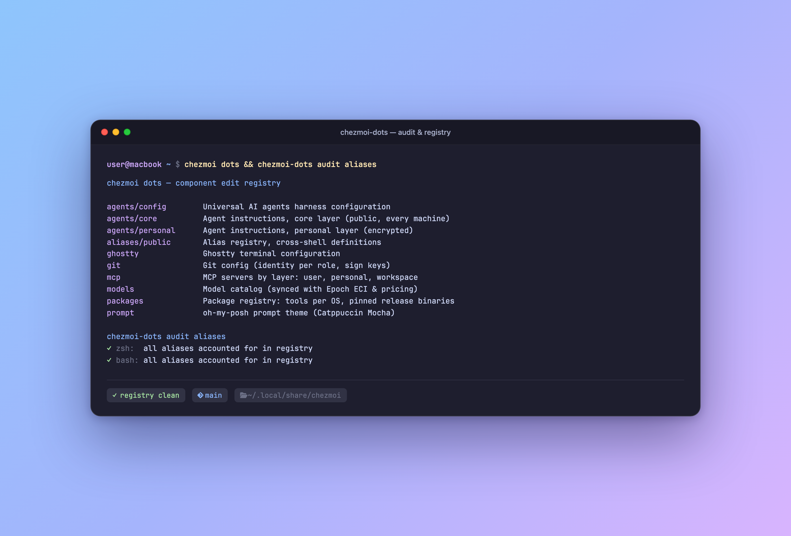

<div align="center">

# chezmoi-dots

**The Developer Companion Plugin for Chezmoi.**  
Declarative registry-driven editing, package survey and drift detection, pin bumping, a dotfiles status check, template dependency graphs, and live preview.

[](https://github.com/giocaizzi/chezmoi-dots/releases/latest)
[](https://github.com/giocaizzi/chezmoi-dots/actions/workflows/ci.yml)
[](LICENSE)

<p align="center">
  
</p>

</div>

[chezmoi](https://www.chezmoi.io/) is an exceptional dotfiles engine, but editing encrypted secrets, inspecting template composition DAGs, auditing external release versions, and previewing changes in real-time often requires hand-rolled scripts.

`chezmoi-dots` is a compiled Go plugin that extends `chezmoi` with a declarative, interactive developer toolkit.

---

## Highlights

- **Registry-Driven Editing (`dots <target>`)**: Open dotfiles by logical alias (`dots zsh`, `dots git`, `dots ssh/config`) with pre-save linters, atomic temp files, and post-save formatters.
- **Zero-Config Fallback**: Works on any `chezmoi managed` repository without configuration—fuzzy pick and edit any managed target directly.
- **Add & Register (`dots add`)**: Bring a new file under chezmoi and register it for editing in one step.
- **Status Snapshot (`dots status`)**: See the dotfiles checkout (branch, ahead/behind, local changes) and what `chezmoi apply` would change, without touching the network.
- **Package Survey & Pins (`dots pkg status`, `dots pkg bump`)**: Query Homebrew, Apt, winget, uv, npm, and GitHub Releases to detect version drift against your pins. Also tracks commit-pinned archive externals. Update pins with comment-preserving text edits.
- **Live Preview**: Editing can render live updates to a side pane using tmux or Windows Terminal; `live` is the internal pane command.
- **Template Composition (`dots view`)**: Inspect a target's composition tree and rendered content, including previews across OS/profile configurations.
- **Template Linting (`dots lint`)**: Verify template syntax, detect unrendered delimiters, and render shell, zsh, PowerShell and JSON templates for every OS/profile configuration and lint them.

---

## Installation

### With Chezmoi (Recommended)

Declare `chezmoi-dots` as an external in your dotfiles repository:

```toml
# .chezmoiexternal.toml.tmpl
{{- /* Set $v to the latest release version (without the leading v), see below. */ -}}
{{- $v := "X.Y.Z" }}
{{- $exe := ternary ".exe" "" (eq .chezmoi.os "windows") }}
[".local/bin/chezmoi-dots{{ $exe }}"]
type = "file"
url = "https://github.com/giocaizzi/chezmoi-dots/releases/download/v{{ $v }}/chezmoi-dots_{{ $v }}_{{ .chezmoi.os }}_{{ .chezmoi.arch }}{{ $exe }}"
executable = true
```

Replace `X.Y.Z` with the [latest release](https://github.com/giocaizzi/chezmoi-dots/releases/latest); the version is the tag without the `v`:

```bash
gh release view --repo giocaizzi/chezmoi-dots --json tagName -q .tagName
```

To keep it current, declare it in your package registry and let `chezmoi dots pkg bump` update it; see [Update a dotfiles repository to the new release](docs/release.md#update-a-dotfiles-repository-to-the-new-release).

Release assets exist for darwin/amd64, darwin/arm64, linux/amd64, linux/arm64 and windows/amd64. Optionally add `checksum.sha256` from the release's `checksums.txt`.

Once the binary is on your `PATH` (for example `~/.local/bin`), chezmoi automatically delegates:

```bash
chezmoi dots <command>
```

Add a shell alias for convenience:

```bash
alias dots="chezmoi dots"
```

### Standalone

```bash
go install github.com/giocaizzi/chezmoi-dots/cmd/chezmoi-dots@latest
```

---

## Commands Reference

| Command | Arguments | Description |
|---|---|---|
| `dots [edit]` | `[<what>]` | Edit a registry entry, source file or managed target; omitting the selector opens a picker |
| `dots add` | `<path>` | Manage a file and register it for editing |
| `dots view` | `[<what>]` | Preview rendered content and composition; `--matrix` shows all configurations |
| `dots list` | none | List configured editable registry components |
| `dots status` | none | Show the dotfiles checkout and what `chezmoi apply` would change |
| `dots upgrade` | `[<step>...]` | Update dotfiles and tools via their native managers |
| `dots lint` | `[<check>...]` | Lint registries, template syntax, and matrix rules |
| `dots audit` | `[<check>...]` | Audit live shell aliases and [secret-manager CLIs](docs/secrets.md) against their registries |
| `dots pkg status` | none | Survey installed packages against pins and upstream releases |
| `dots pkg bump` | `[<pin>...]` | Fetch latest releases and archive commits, and update the pins in the registry and externals files |
| `dots pkg add` | `<name>` | Add a package or pinned release to `packages.toml` |
| `dots secrets run` | `<name> [--] <args...>` | Run a declared [secret-manager CLI](docs/secrets.md#running-a-cli-with-its-token-secrets-run) with its token injected |
| `dots version` | none | Print the binary version |
| `dots help` | `[<command> [<subcommand>]]` | Show root or local help |

Use `dots <command> --help` for command-specific options. See the full
[command reference](docs/cli.md) for defaults, environment, parsing and exit
semantics, including the internal `live` command. The day-to-day procedures are
in the [everyday workflow](docs/workflow.md) runbook, and the format of `.chezmoidata/packages.toml` that `pkg` and `lint packages` read is in the [package registry](docs/registry.md) reference. The [edit registry](docs/edit-registry.md) documents the `.chezmoidata/edit.toml` that `edit` and `add` use, and the [alias registry](docs/alias-registry.md) the alias data that `lint aliases` and `audit aliases` read. For source builds, see
[Build and install locally](docs/local-build-install.md); maintainers publish versions with the [release runbook](docs/release.md).

See [Apply and publish source edits](docs/README.md#apply-and-publish-source-edits) for the chezmoi settings that control apply and Git automation.

---

## License

[MIT](LICENSE) © Giorgio Caizzi
