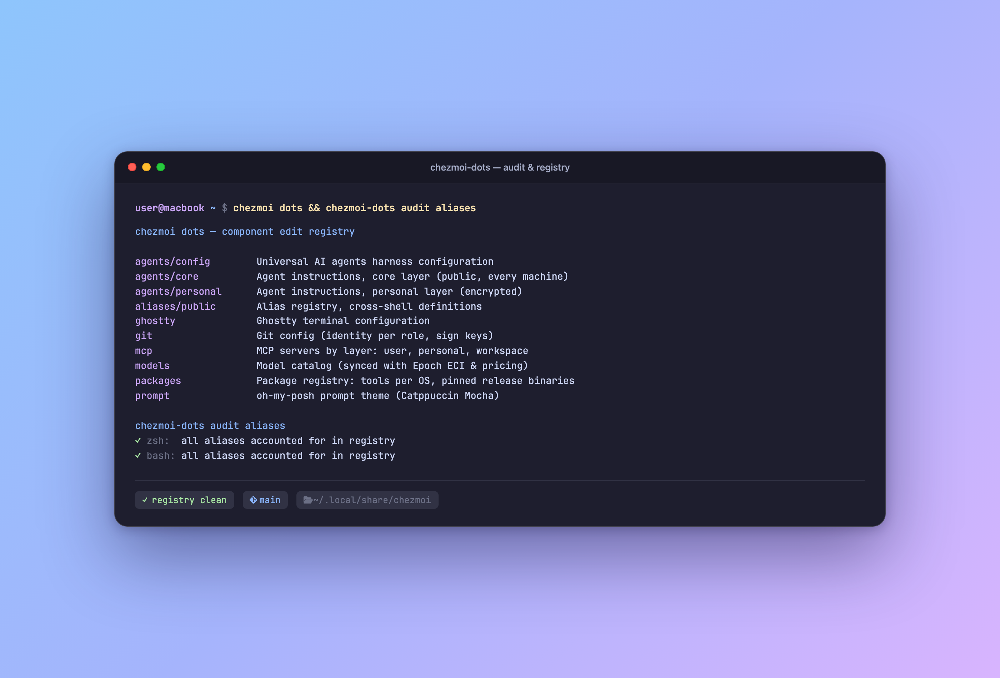

<div align="center">

# chezmoi-dots

**The Developer Companion Plugin for Chezmoi.**  
Declarative registry-driven editing, package inventory drift detection, automated release bumping, template dependency graphs, and live preview.

[](https://github.com/giocaizzi/chezmoi-dots/releases/latest)
[](https://github.com/giocaizzi/chezmoi-dots/actions/workflows/ci.yml)
[](LICENSE)

<p align="center">
  
</p>

</div>

[chezmoi](https://www.chezmoi.io/) is an exceptional dotfiles engine, but editing encrypted secrets, inspecting template composition DAGs, auditing external release versions, and previewing changes in real-time often requires hand-rolled scripts.

`chezmoi-dots` is a compiled Go plugin that extends `chezmoi` with a declarative, interactive developer toolkit.

---

## Highlights

- **Registry-Driven Editing (`dots <target>`)**: Open dotfiles by logical alias (`dots zsh`, `dots git`, `dots ssh/config`) with pre-save linters, atomic temp files, and post-save formatters.
- **Zero-Config Fallback**: Works on any `chezmoi managed` repository without configuration—fuzzy pick and edit any managed target directly.
- **Inventory & Drift Audit (`dots outdated`, `dots bump`)**: Query Homebrew, Pacman, Apt, and GitHub Releases to detect version drift against your pins. Update pins with comment-preserving text edits.
- **Live Preview**: Editing can render live updates to a side pane using tmux or Windows Terminal; `live` is the internal pane command.
- **Template Composition (`dots view`)**: Inspect a target's composition tree and rendered content, including previews across OS/role configurations.
- **Template Linting (`dots lint`)**: Verify template syntax, detect unrendered delimiters, and validate cross-OS matrix configurations.

---

## Installation

### With Chezmoi (Recommended)

Declare `chezmoi-dots` as a release external in your dotfiles repository:

```toml
# .chezmoidata/packages.toml
[release.chezmoi-dots]
repo = "giocaizzi/chezmoi-dots"
version = "0.1.0"
```

Once installed to `~/.local/bin/chezmoi-dots`, chezmoi automatically delegates:

```bash
chezmoi dots <command>
```

Add a shell alias for convenience:

```bash
alias dots="chezmoi dots"
```

### Standalone

```bash
go install github.com/giocaizzi/chezmoi-dots/cmd/chezmoi-dots@latest
```

---

## Commands Reference

| Command | Arguments | Description |
|---|---|---|
| `dots [edit]` | `[<what>]` | Edit a registry entry, source file or managed target; omitting the selector opens a picker |
| `dots view` | `[<what>]` | Preview rendered content and composition; supports matrix overviews |
| `dots list` | none | List configured editable registry components |
| `dots lint` | `[<check>...]` | Lint registries, template syntax, and matrix rules |
| `dots audit` | `aliases` | Audit live shell environment against alias registry |
| `dots outdated` | none | Survey installed packages against pins and upstream releases |
| `dots bump` | `[<release>...]` | Fetch latest releases and update pinned versions in registry |
| `dots upgrade` | `[<step>...]` | Update dotfiles and tools via their native managers |
| `dots version` | none | Print the binary version |
| `dots help` | `[<command> [<child>]]` | Show root or local help |

Use `dots <command> --help` for command-specific options. See the full
[command reference](docs/cli.md) for defaults, environment, parsing and exit
semantics, including the internal `live` command. For source builds, see
[Build and install locally](docs/local-build-install.md).

See [Apply and publish source edits](docs/README.md#apply-and-publish-source-edits) for the chezmoi settings that control apply and Git automation.

---

## License

[MIT](LICENSE) © Giorgio Caizzi
